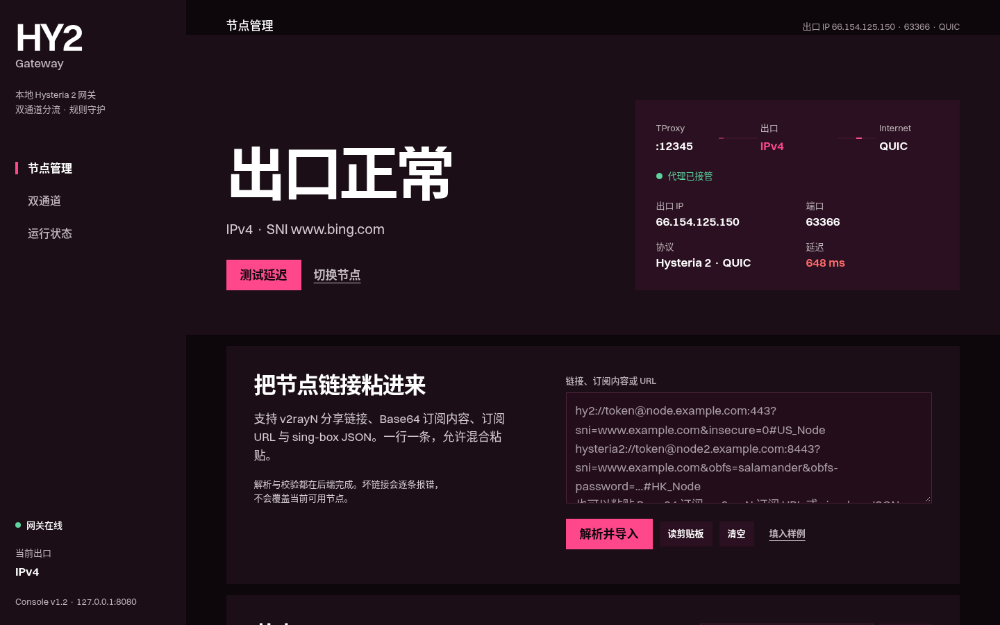
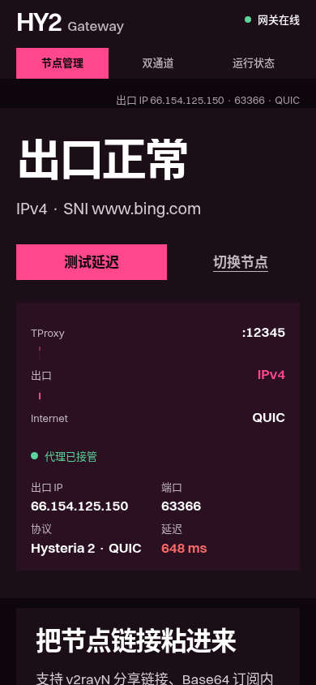
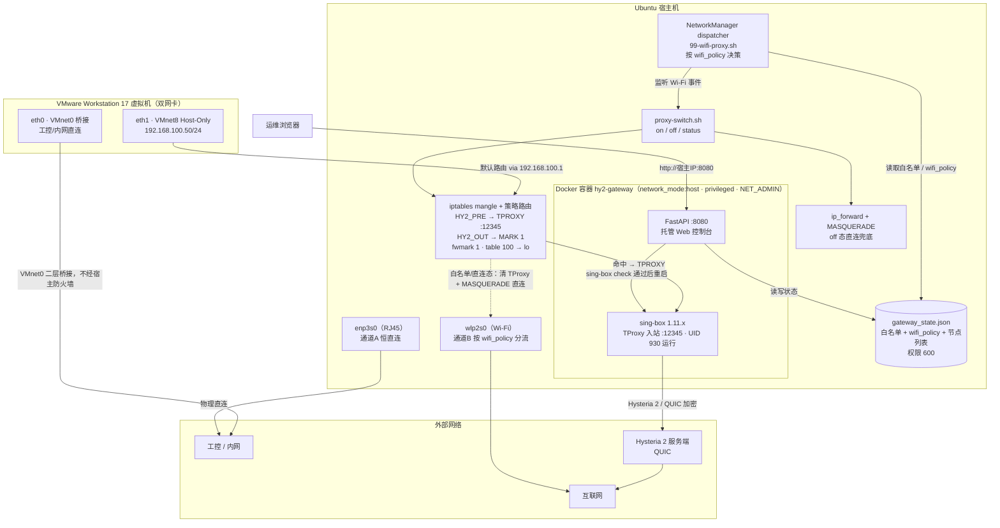

# Smart Hy2 Gateway

**Ubuntu 宿主机双通道智能网关**：RJ45 有线恒直连，Wi-Fi 无线自动走 [Hysteria 2](https://v2.hysteria.network/) (QUIC) 隧道——白名单 SSID 例外直连。VMware 虚拟机双网卡分别搭在两条通道上：工控/内网流量桥接直连，日常互联网流量经宿主机透明代理出站。单容器部署，自带 Web 控制台。





## 双通道模型

| 通道 | 载体 | 策略 | 流量 |
|---|---|---|---|
| **A · 有线** | RJ45 网卡（`rj45_iface`） | 恒直连，规则级硬保证（`-i/-o` 显式 RETURN），永不进隧道 | 宿主机有线 + 虚拟机 eth0 (VMnet0 桥接) |
| **B · 无线** | Wi-Fi 网卡（`wifi_iface`） | `wifi_policy` 三态：`whitelist`（默认，白名单 SSID 例外直连）/ `always_proxy`（强制代理）/ `always_direct`（强制直连） | 宿主机 Wi-Fi + 虚拟机 eth1 (VMnet8 Host-Only) |

Wi-Fi 连接事件由 NetworkManager dispatcher 感知，按 `wifi_policy` 与白名单自动写入/清除 iptables TProxy 规则——全程无感切换，断网自动恢复直连。

## 架构总览



## 核心特性

- **双通道自动分流**：通道A 有线恒直连（iptables 规则级硬保证）；通道B 无线按 `wifi_policy` 三态 + SSID 白名单自动开/关 TProxy，事件驱动、断网自动恢复直连。
- **TProxy 透明代理**：mangle `HY2_PRE`（PREROUTING）+ `HY2_OUT`（OUTPUT）配合 fwmark 1 / table 100 策略路由，宿主机与虚拟机流量无感接管；UID 930 owner 放行杜绝 sing-box 自身回环。
- **Hysteria 2 (QUIC) 出站**：sing-box 1.11.x 以专用 UID + `cap_net_admin` 运行，配置经 `sing-box check` 校验通过后才落盘重启，坏配置不破坏运行态。
- **Web 控制台**（节点管理 / 双通道 / 运行状态三视图；深色控制台外壳，桌面左侧导航、移动端顶部导航；断网自动演示模式、恢复自动回在线）：
  - **节点管理（v2rayN 式）**：多节点列表与启用切换；首屏显示当前**出口 IP、端口、Hysteria 2 · QUIC 协议与实测延迟**；粘贴单条/多条 v2rayN `hy2://` 分享链接、整段 base64 订阅内容或订阅 URL 批量导入，亦支持 sing-box JSON（完整配置 / 单 outbound）。导入自动去重、标签冲突加后缀，兼容 `hysteria2://`、`allowInsecure` 别名、`pinSHA256`（sing-box 不支持证书锁定，insecure 下显式忽略）、`mport`/`ports` 端口跳跃（需 sing-box 1.11+；带宽缺省 = BBR 自适应）；支持真实延迟测试、编辑 / 重命名 / 删除；连通性分段诊断（DNS / 国内·国际直连 TCP / 节点解析 / 节点 UDP 静默探测）
  - **双通道**：宿主真实网卡下拉选择（类型过滤）；通道策略三态切换；白名单管理；顶部使用虚化实景背景，不占用配置版面
  - **运行状态**：sing-box / TProxy 规则实况 / 通道策略 / Wi-Fi 通道四读数，手动启停，运维速查
- **REST API**：`/api/state` · `/api/apply` · `/api/status` · `/api/proxy` · `/api/interfaces` · `/api/nettest` · `/api/nodes`（节点列表） · `/api/nodes/import`（批量导入） · `/api/nodes/{id}/activate`（启用切换） · `PATCH/DELETE /api/nodes/{id}`（编辑 / 删除） · `/api/nodes/test`（真实延迟测试）
- **地理分流（v2rayN 式「绕过大陆」）**：代理开启时中国域名/IP（geosite-cn / geoip-cn 规则集，随仓库 `ruleset/` 内置、构建与运行零外联下载）自动直连，其余走 Hysteria 2 隧道；DNS 同步拆分——国内域名用 223.5.5.5 解析（CDN 友好），国外域名经隧道解析（防污染）。
- **规则守护（rule-guard）**：dispatcher 每次决策落盘期望态，后端每 30s 将 iptables 实况对齐——任何原因（容器重建、系统事件）导致的规则丢失在一个周期内自动恢复；Wi-Fi 波动断连不清规则。
- **Host-Only 虚拟机直连兜底**：代理关闭时脚本确保 `ip_forward` + MASQUERADE，虚拟机不断网。

## 快速开始

```bash
# 1. 克隆到部署目录（dispatcher 与状态文件路径按 /opt/hy2-gateway 约定）
git clone https://github.com/Roarpeng/smart-hy2-gateway.git /opt/hy2-gateway
cd /opt/hy2-gateway

# 2. 安装宿主侧脚本 (TProxy 开关 + NetworkManager 钩子 + 种子状态)
sudo ./install.sh

# 3. 构建并启动容器
docker compose up -d --build
```

浏览器打开 `http://宿主IP:8080`：节点管理页粘贴一条或多条 v2rayN 分享链接 / base64 订阅 / 订阅 URL → 导入列表 → 启用节点（自动校验并重启 sing-box）→ 做延迟测试；「双通道」页选好两张网卡与通道策略（默认「走代理·白名单例外」）→ 点「保存网卡配置」；断开重连一次 Wi-Fi 即生效。

> 仅接管 IPv4。VMware 虚拟网络（VMnet0 桥接 / VMnet8 Host-Only）配置见 [docs/vmware-setup.md](docs/vmware-setup.md)。

## 仓库文件

```
smart-hy2-gateway/（部署目录 = /opt/hy2-gateway）
├── README.md · LICENSE
├── install.sh                       一键安装宿主脚本 + 种子状态 (幂等)
├── docker-compose.yml · Dockerfile · entrypoint.sh · requirements.txt
├── backend_app.py                   FastAPI 后端 (API + sing-box 进程守护)
├── node_parser.py                   分享链接 / base64 订阅 / sing-box JSON 解析与去重
├── scripts/
│   ├── proxy-switch.sh              TProxy 开关 (on/off/status, 幂等, RJ45 硬直连)
│   └── 99-wifi-proxy.sh             NetworkManager dispatcher (wifi_policy 决策)
├── ruleset/                         地理分流规则集 (geosite/geoip CN 直连, 构建时内置镜像)
├── web/                             控制台前端 (零框架, 自托管 Switzer 字体, 断网可用)
│   ├── index.html · console.css · console.js
│   ├── assets/                      实景照片与版权说明 (CREDITS.md)
│   ├── fonts/                       Switzer WOFF2 与授权说明
├── data/                            运行时状态 (含节点口令, 已 gitignore)
├── tests/
│   └── test_node_parser.py          解析器公共契约单元测试 (标准库 unittest)
├── docs/
│   ├── deploy.md                    部署运维手册 (验证清单/切换测试/排障/卸载)
│   ├── vmware-setup.md              VMware 虚拟网络与虚拟机双网卡配置
│   └── screenshot-console.png · screenshot-mobile.png
└── smart_hysteria_2_gateway_architecture_management_console.html
                                     原始设计原型 (归档参考, 实际以 web/ 为准)
```

## 安全须知

- **明文口令**：`data/gateway_state.json` 以明文保存全部节点口令，权限 600，仅 root 可读，已列入 `.gitignore`——**严禁提交或拷贝到不可信介质**。
- **订阅拉取 SSRF 防护**：订阅 URL 仅允许 `http/https`，后端在发起请求前拒绝私网、回环、链路本地地址；同时限制超时与响应大小，避免被用作内网探测或内存耗尽入口。
- **特权容器**：`network_mode: host` + `privileged` 等价于直接操作宿主网络栈，只能在自有可信设备上部署。
- **WebUI 无鉴权**：:8080 请勿暴露到不可信网络（建议仅局域网/回环访问）。
- **仅接管 IPv4**：双栈 Wi-Fi 下 IPv6 直连出站；如需封死请对 Wi-Fi 连接 `nmcli connection modify "<名>" ipv6.method disabled`。
- **排障恢复**：`sudo /usr/local/bin/proxy-switch.sh off` 一键清规则恢复直连。

## 文档

- [docs/deploy.md](docs/deploy.md) — 部署步骤、验证清单、Wi-Fi 切换与策略模式测试、故障排查、卸载
- [docs/vmware-setup.md](docs/vmware-setup.md) — Virtual Network Editor、虚拟机 netplan 双网卡、为何 Host-Only 而非 NAT

## License

[MIT](LICENSE) © Roar (Roarpeng)
