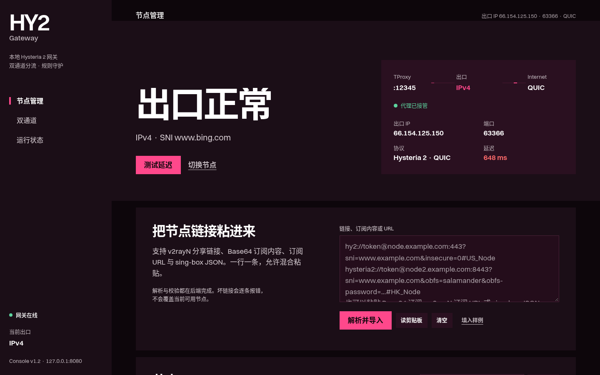
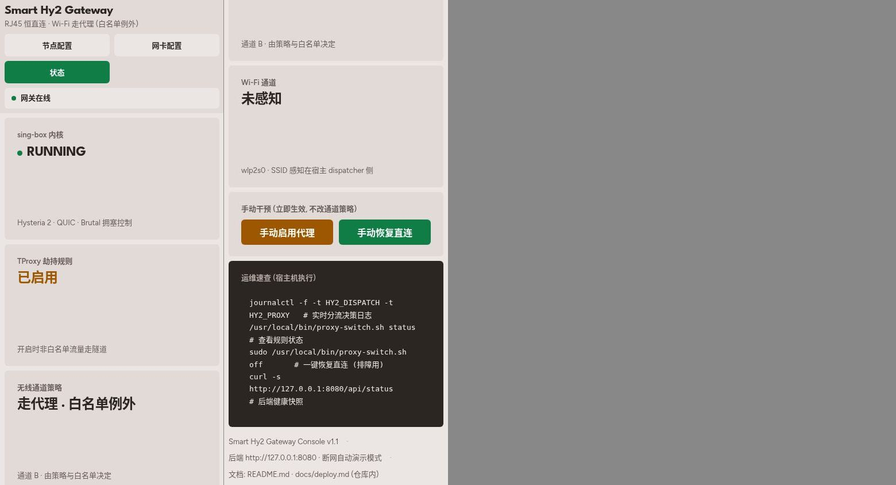
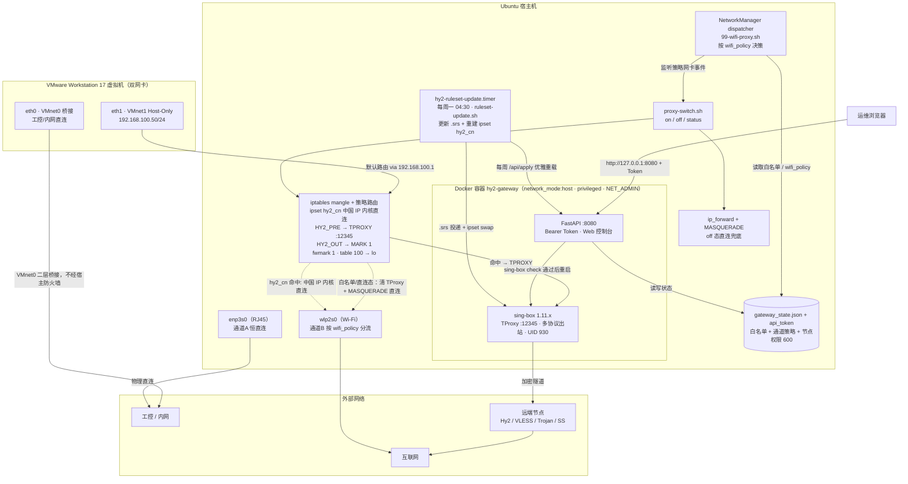

# Smart Hy2 Gateway

**Ubuntu 宿主机双通道透明代理网关**（v1.1）：按角色自选「恒直连 / 策略代理」网卡（物理或虚拟均可），出站经 [sing-box](https://sing-box.sagernet.org/) 支持 **Hysteria 2 / VLESS(+Reality) / Trojan / Shadowsocks**；可选 VMware 双网卡分流。单容器部署，自带鉴权 Web 控制台。





## 双通道模型

| 通道 | 载体 | 策略 | 流量 |
|---|---|---|---|
| **A · 恒直连** | 用户自选网卡（字段 `rj45_iface`，介质不限） | 恒直连，mangle `-i/-o` RETURN，永不进隧道 | 常映射到桥接物理口 / 虚拟机直连网卡 |
| **B · 策略代理** | 用户自选网卡（字段 `wifi_iface`，介质不限） | `wifi_policy` 三态：`whitelist` / `always_proxy` / `always_direct`（SSID 白名单仅 Wi‑Fi 有效） | 常映射到 Wi‑Fi 或 Host-Only VM 上行 |

策略通道为 Wi‑Fi 时，NetworkManager dispatcher 按 `wifi_policy` 与白名单自动开/关 TProxy；非 Wi‑Fi 时用控制台手动开关或 `always_*` 策略。虚拟网卡可在控制台选择，并尽量标注 VMware 桥接关系。

## 架构总览



## 核心特性

- **双通道角色分流**：恒直连 / 策略代理网卡由用户自选（以太网、Wi‑Fi、vmnet、网桥均可）；SSID 白名单仅在策略网卡为 Wi‑Fi 时生效；控制台可标注并建议 VMware 虚拟网卡映射。
- **TProxy 透明代理**：mangle `HY2_PRE` + `HY2_OUT` 配合 fwmark / 策略路由；UID 930 防回环；`hy2_cn` 中国 IP 内核直连；`sysctl fq` 对 QUIC pacing 友好。
- **多协议出站**：sing-box 1.11.x 支持 Hysteria 2、VLESS（含 Reality）、Trojan、Shadowsocks；配置经 `sing-box check` 后才落盘重启。可设备用节点组成 **urltest**，主节点不可用时自动降级。
- **Web 控制台**（节点 / 双通道 / 运行状态；API Token 门禁；断网演示模式）：
  - **节点管理**：导入 `hy2://` `vless://` `trojan://` `ss://`、base64 订阅、订阅 URL、sing-box JSON；启用 / 备用 / 延迟测试 / 编辑删除
  - **双通道**：网卡下拉（含虚拟网卡标签）、策略三态、白名单、VM 上网映射
  - **运行状态**：sing-box / TProxy / 策略 / Wi‑Fi 读数，手动启停，连通性诊断
- **REST API**（除 `/api/health` 外需 Bearer Token）：`/api/state` · `/api/apply` · `/api/status` · `/api/proxy` · `/api/interfaces` · `/api/nettest` · `/api/egress` · `/api/nodes*`（含 `…/fallback`）· `/api/nodes/test`
- **地理分流（绕过大陆）**：通道策略 → ipset `hy2_cn` 内核直连 → sing-box geosite/geoip；DNS 国内/隧道拆分。规则集镜像内置、每周自动更新。
- **规则集每周自动更新（systemd timer）**：`hy2-ruleset-update.timer` 每周一 04:30 触发（±10 分钟随机抖动，`Persistent=true` 错过补跑）执行 `ruleset-update.sh`：从 SagerNet 官方（sing-geosite / sing-geoip 的 rule-set 分支）下载 `geosite-cn.srs` / `geoip-cn.srs` → 尺寸校验 → 原子替换仓库 `ruleset/` → `docker cp` 投递容器 `/usr/local/share/sing-box/` → 从同一份 `geoip-cn.srs` 用 `sing-box rule-set decompile` 导出 CIDR、原子重建 ipset `hy2_cn`（单一数据源）→ 若代理在开则确保 match 规则在位 → 经后端 `/api/apply` 触发 sing-box 优雅重载。全程 fail-safe：下载失败或校验不过即保留现有规则集，重载前 `sing-box check` 通过才重启进程，坏文件不破坏运行态。`install.sh` 一并安装脚本与 timer（`enable --now`）、检查 `curl`/`jq`/`ipset` 依赖，并在安装尾声 best-effort 首跑一次。
- **规则守护（rule-guard）**：dispatcher 每次决策落盘期望态，后端每 30s 将 iptables 实况对齐——任何原因（容器重建、系统事件）导致的规则丢失在一个周期内自动恢复；Wi-Fi 波动断连不清规则。
- **Host-Only 虚拟机直连兜底**：代理关闭时脚本确保 `ip_forward` + MASQUERADE，虚拟机不断网。
- **VMware 虚拟网络兜底（vmnet-guard）**：`/dev` 为 tmpfs，`vmware.service` 创建 `/dev/vmnetN` 存在时序空档——虚拟机若在节点就绪前启动，vmx 会报 `MACVNetPortOpenDevice: can't open vmnet device` 并把网卡标记为 `startdisconnected` 后**永不重试**，表现为虚拟机永久断网而宿主侧 iptables/路由全部正常，极难定位。`vmnet-guard.service` 开机等待 `vmware.service` 后就绪检查、按主设备号 119 补建 `/dev/vmnet0/1/8`（幂等，不触碰已存在节点），`install.sh` 一并安装启用；非 VMware 宿主由 `ConditionPathExists` 自动跳过。诊断依据：`ls -l /proc/$(pgrep -f bin/vmware-vmx | head -1)/fd | grep vmnet`，只有 `vmnet0` 即代理网卡未接入。

## 快速开始

```bash
# 1. 克隆到部署目录（dispatcher 与状态文件路径按 /opt/hy2-gateway 约定）
git clone https://github.com/Roarpeng/smart-hy2-gateway.git /opt/hy2-gateway
cd /opt/hy2-gateway

# 2. 安装宿主侧脚本 (TProxy 开关 + NetworkManager 钩子 + 种子状态 + API Token)
sudo ./install.sh

# 3. 构建并启动容器（默认仅本机访问控制台）
docker compose up -d --build
# 局域网访问: ALLOW_LAN=1 docker compose up -d --build
```

浏览器打开 `http://127.0.0.1:8080`，粘贴 `install.sh` 打印的 API Token（或 `data/api_token`）；导入节点 → 启用（可选「设为备用」）→「双通道」页选择恒直连 / 策略代理网卡 → 保存。策略网卡为 Wi‑Fi 时，断开重连一次即可触发 dispatcher。

> 仅接管 IPv4。纯宿主见 [docs/bare-metal.md](docs/bare-metal.md)；VMware 见 [docs/vmware-setup.md](docs/vmware-setup.md)。

## 仓库文件

```
smart-hy2-gateway/（部署目录 = /opt/hy2-gateway）
├── README.md · LICENSE · CHANGELOG.md · SECURITY.md · CONTRIBUTING.md
├── .github/workflows/               CI + GHCR 镜像发布
├── install.sh                       一键安装宿主脚本 + 种子状态 + API Token (幂等)
├── docker-compose.yml · Dockerfile · entrypoint.sh · requirements.txt
├── backend_app.py                   FastAPI 后端 (API + sing-box 进程守护)
├── node_parser.py                   分享链接 / base64 订阅 / sing-box JSON 解析与去重
├── scripts/
│   ├── proxy-switch.sh              TProxy 开关 (on/off/status, 幂等, RJ45 硬直连)
│   ├── 99-wifi-proxy.sh             NetworkManager dispatcher (wifi_policy 决策)
│   ├── ruleset-update.sh            规则集每周更新 (下载→校验→原子替换→投递容器→重建 ipset)
│   ├── hy2-vmnet1-dhcp.sh           VMnet1 DHCP 网关服务 (下发网关 192.168.100.1 + DNS)
│   ├── vmnet-ensure.sh              vmnet 设备兜底 (开机补建 /dev/vmnet0/1/8)
│   └── systemd/
│       ├── hy2-ruleset-update.service
│       ├── hy2-ruleset-update.timer
│       ├── hy2-vmnet1-dhcp.service
│       └── vmnet-guard.service
│                                    定时单元 (每周一 04:30 触发, ±10min 抖动, 错过补跑)
├── ruleset/                         地理分流规则集 (geosite/geoip CN 直连, 镜像内置, 每周自动更新)
├── web/                             控制台前端 (零框架, 自托管 Switzer 字体, 断网可用)
│   ├── index.html · console.css · console.js
│   ├── assets/                      实景照片与版权说明 (CREDITS.md)
│   ├── fonts/                       Switzer WOFF2 与授权说明
├── data/                            运行时状态 (含节点口令, 已 gitignore)
├── tests/
│   └── test_node_parser.py          解析器公共契约单元测试 (标准库 unittest)
├── docs/
│   ├── deploy.md                    部署运维手册 (验证清单/切换测试/排障/卸载)
│   ├── vmware-setup.md              VMware 虚拟网络与虚拟机双网卡配置
│   └── screenshot-console.png · screenshot-mobile.png
└── smart_hysteria_2_gateway_architecture_management_console.html
                                     原始设计原型 (归档参考, 实际以 web/ 为准)
```

## 安全须知

- **API Token**：`/api/*`（除 `/api/health`）需要 `Authorization: Bearer <token>`。Token 来自环境变量 `GATEWAY_TOKEN` 或文件 `data/api_token`（`install.sh` / 容器首次启动会生成）。控制台首次打开会提示粘贴 Token。
- **默认本机监听**：Web 默认绑定 `127.0.0.1`；需要局域网访问时设置 `ALLOW_LAN=1`（仍须携带 Token）。
- **明文口令**：`data/gateway_state.json` 以明文保存全部节点口令，权限 600，仅 root 可读，已列入 `.gitignore`——**严禁提交或拷贝到不可信介质**。API 响应默认打码口令。
- **订阅拉取 SSRF 防护**：订阅 URL 仅允许 `http/https`，后端在发起请求前拒绝私网、回环、链路本地地址；同时限制超时与响应大小，避免被用作内网探测或内存耗尽入口。
- **特权容器**：`network_mode: host` + `privileged` 等价于直接操作宿主网络栈，只能在自有可信设备上部署。
- **仅接管 IPv4**：双栈 Wi-Fi 下 IPv6 直连出站；如需封死请对 Wi-Fi 连接 `nmcli connection modify "<名>" ipv6.method disabled`。
- **排障恢复**：`sudo /usr/local/bin/proxy-switch.sh off` 一键清规则恢复直连。
- 漏洞披露见 [SECURITY.md](SECURITY.md)。赞助 / 赞赏：GitHub Sponsors（软件 MIT 免费，不卖节点）。

## 文档

- [docs/deploy.md](docs/deploy.md) — 部署步骤、验证清单、Wi-Fi 切换与策略模式测试、故障排查、卸载
- [docs/bare-metal.md](docs/bare-metal.md) — 非 VMware 纯宿主精简路径
- [docs/vmware-setup.md](docs/vmware-setup.md) — Virtual Network Editor、虚拟机 netplan 双网卡、为何 Host-Only 而非 NAT
- [CHANGELOG.md](CHANGELOG.md) · [SECURITY.md](SECURITY.md) · [CONTRIBUTING.md](CONTRIBUTING.md)

预构建镜像（打 `v*` tag 后推送）：`ghcr.io/<owner>/smart-hy2-gateway`（以仓库 Actions 为准）。

## License

[MIT](LICENSE) © Roar (Roarpeng)
